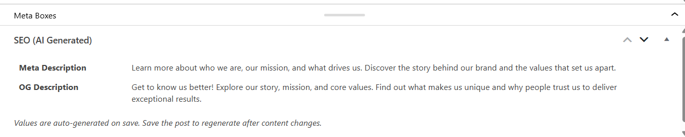

# SolarCompany — WordPress Theme with AI SEO Automation

Custom WordPress theme for a solar energy B2B company, built on ACF Pro + Gutenberg blocks. Includes an LLM-powered SEO module that auto-generates meta descriptions on every post save via the Anthropic Claude API.

## Stack

- **WordPress** + **ACF Pro** (Gutenberg blocks, custom fields)
- **PHP 8.4**, **Webpack 5**, **SCSS**, **Babel**
- **Anthropic Claude API** — auto-generates `meta description` and `og:description`
- **DDEV** for local development (Docker: nginx-fpm, MariaDB 11.4)

## AI Feature: SEO Automation

`wp-content/themes/solarcompany/inc/seo-ai.php`

On every publish or update, WordPress fires the `save_post` hook. The theme schedules a background WP-Cron job that reads the page title and content, sends it to Claude, and saves the generated meta tags to `post_meta`. The result appears in a read-only **"SEO (AI Generated)"** meta box in the editor and is output in `<head>` on the front end.

**How it works:**
- Background generation via WP-Cron — editor save is never blocked
- Regenerates only when content changes (md5 hash check)
- Strips markdown code fences from Claude's response before parsing
- Logs parse errors to PHP error log for visibility
- Skips output when Yoast SEO or Rank Math is active (no duplicate tags)
- Model name exposed via `seo_ai_model` filter for easy override



## How I verified the result

1. Added a real Anthropic API key to `wp-config.php`
2. Deleted the placeholder meta values: `ddev wp post meta delete <ID> _seo_ai_meta_description`
3. Triggered generation: `ddev wp post update <ID> --post_status=publish && ddev wp cron event run seo_ai_process_post`
4. Checked the output: `ddev wp post meta get <ID> _seo_ai_meta_description`
5. Verified the tag appears in page source: `curl -s https://solarcompany.ddev.site/<slug>/ | grep 'meta name="description"'`

Result for post "Solar 101: Understanding How Solar Works":
> *Discover how solar energy works with our Solar 101 guide. Learn the basics of solar panels, energy conversion, and how to power your home with the sun.*

## Local Setup

**Requirements:** [DDEV](https://ddev.com/) and Docker.

```bash
git clone https://github.com/yuliiaolkhovskawork-source/solarcompany.git
cd solarcompany
ddev start
```

Add your Anthropic API key to `wp-config.php` (see `wp-config.example.php`):

```php
define( 'ANTHROPIC_API_KEY', 'sk-ant-...' );
```

**Frontend build:**

```bash
cd wp-content/themes/solarcompany/assets
npm install
npm run dev    # dev server with HMR
npm run build  # production build
```

Site runs at `https://solarcompany.ddev.site`

## Plugins required

Install these manually or via your preferred method:

- Advanced Custom Fields Pro
- ACF Nav Menu Field
- SVG Support
- Duplicate Post
- Mailchimp for WordPress
